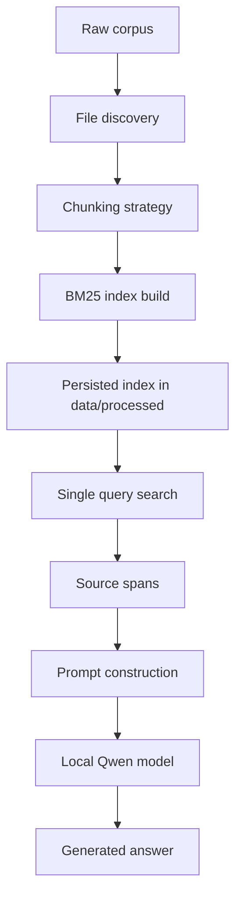

*This project has been created as part of the 42 curriculum.*

# RAG against the machine 🤖

This repository implements a Retrieval-Augmented Generation pipeline for the vLLM codebase. The current codebase is a partial but working foundation for corpus indexing and lexical retrieval, and it is not yet fully compliant with the mandatory subject requirements.

## Project status

The project is in a partial but useful state:

- Implemented and validated: directory discovery, Python/text/plain chunking, BM25 indexing, persistence to disk, single-query search with the CLI.
- Partially implemented: dataset search CLI and local LLM wrapper.
- Not complete: answer dataset generation, evaluation command, recall validation against the provided datasets, complete error handling review, final README compliance, and required project-level checks.

The project should therefore be considered a working prototype, not a finished submission for the subject.

---

## Description

The goal is to index a large codebase, retrieve the most relevant source spans for a question, and use them as evidence for a local model. The subject expects a complete RAG workflow: index the corpus, search datasets, generate grounded answers, and evaluate retrieval with recall@k.

In the current implementation, the core retrieval engine is a BM25 index built with `bm25s` and an English stemmer. The chunkers split Python files and prose/text files into spans under the required 2000-character limit. The system can index the provided corpus and search it for a single question.

---

## System architecture



The architecture follows the mandatory RAG stages:

1. Ingest the raw corpus from the project tree.
2. Split files into indexable chunks with file-type-aware logic.
3. Build a lexical retrieval index over those chunks.
4. Query the index using BM25.
5. Assemble a prompt from the retrieved content.
6. Generate an answer with a local model.
7. Evaluate retrieval quality against reference datasets.

---

## Chunking strategy

The code in [src/chunker.py](src/chunker.py) implements a layered approach:

- Python files use a top-level AST-based chunker; if a node is too large, it falls back to line-based splitting.
- Markdown/text files use a prose-aware chunker that cuts on paragraph and punctuation boundaries.
- Unknown or generic file types fall back to line-based splitting.

This keeps chunk lengths under the required 2000-character cap and avoids returning oversized source spans.

---

## Retrieval method

The retrieval system in [src/indexer.py](src/indexer.py) uses BM25 as the primary lexical ranking method:

- the corpus is tokenized with stopword removal and English stemming,
- the index is built over chunk text,
- a query is tokenized similarly,
- the system returns the top-k chunks with BM25 scores.

This part is the strongest part of the current implementation and is the only stage that is clearly working end-to-end in practice.

---

## Performance and current validation

Current verified behavior:

- `uv run python -m src index --max_chunk_size 2000` succeeds and builds the index in under 20 seconds on the provided corpus.
- `uv run python -m src search "how to load a LoRA adapter" --k 5` returns valid chunks with file paths and character spans.

The following subject requirements are still not completed or not validated:

- recall@k against the official ground-truth dataset is not implemented in [src/__main__.py](src/__main__.py),
- answer generation is not fully verified end-to-end because the local model load path can block during model initialization,
- dataset-level answer generation remains incomplete,
- no proof of the required threshold performance has been produced,
- no pytest suite or lint pass was demonstrated.

---

## Design decisions

The current design intentionally keeps the implementation simple and modular:

- [src/models.py](src/models.py) centralizes data validation with Pydantic,
- [src/files_crawler.py](src/files_crawler.py) isolates the discovery logic,
- [src/chunker.py](src/chunker.py) isolates chunking strategy selection,
- [src/indexer.py](src/indexer.py) owns index building and search,
- [src/llm.py](src/llm.py) isolates model prompting and generation,
- [src/__main__.py](src/__main__.py) exposes the Fire CLI.

This separation makes the project easier to debug and expand, but it also shows that the final pipeline still needs integration and validation work.

---

## Challenges faced

The main difficulties are not conceptual but project-integration related:

- ensuring chunk spans stay within the 2000-character bound,
- keeping the CLI interface compatible with Fire and the expected commands,
- making the BM25 index persist and reload cleanly,
- handling local model initialization efficiently and reliably,
- matching the exact output format and semantics required by the subject.

The index/search core has been solved well enough to work, but the remaining challenge is integration and verification across the full mandatory flow.

---

## Instructions

### Install dependencies

```bash
make install
```

### Index the corpus

```bash
uv run python -m src index --max_chunk_size 2000
```

### Search a single question

```bash
uv run python -m src search "how to load a LoRA adapter" --k 5
```

### Search a dataset

```bash
uv run python -m src search_dataset \
  --dataset_path data/datasets/UnansweredQuestions/dataset_docs_public.json \
  --k 10 \
  --save_directory data/output/search_results/UnansweredQuestions
```

### Generate an answer for a single question

```bash
uv run python -m src answer "how to load a LoRA adapter" --k 5
```

### Generate dataset answers

```bash
uv run python -m src answer_dataset \
  --student_search_results_path data/output/search_results/UnansweredQuestions/dataset_docs_public.json \
  --save_directory data/output/search_results_and_answer/UnansweredQuestions
```

### Evaluate retrieval scores

This command is still not implemented in the project, and the subject explicitly states that the official scorer is provided as a separate moulinette binary.

---

## Resources

- vLLM repository: https://github.com/vllm-project/vllm
- BM25S: https://github.com/xhluca/bm25s
- Hugging Face Transformers: https://huggingface.co/docs/transformers
- Pydantic: https://docs.pydantic.dev/

AI usage:

This project used AI assistance to help structure the RAG pipeline, review the subject constraints, and reason about chunking and indexing choices. The generated code was then checked against the repository structure and the subject requirements, and it remains the author’s responsibility to validate correctness before relying on it.

---

## Example usage

```bash
make install
uv run python -m src index --max_chunk_size 2000
uv run python -m src search "how to load a LoRA adapter" --k 10
```

This project is still incomplete relative to the full mandatory specification and will require additional implementation and validation work before it can be considered ready for the subject evaluation.
