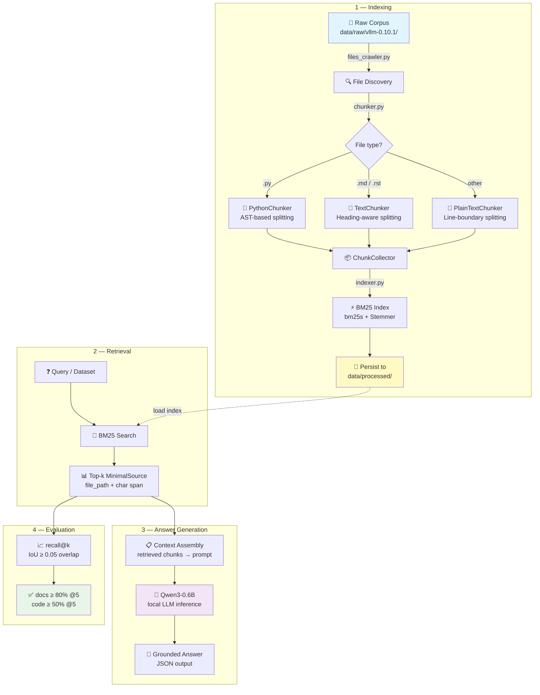

*This project has been created as part of the 42 curriculum.*

# RAG against the machine 🤖

A Retrieval-Augmented Generation system that answers questions about the [vLLM](https://github.com/vllm-project/vllm) codebase. Ingest, index, retrieve, and generate — measured by recall@k.

---

## Pipeline Architecture



## Step-by-step Plan

```mermaid
graph LR
    S1[Step 1<br>Project Setup] --> S2[Step 2<br>Data Models]
    S2 --> S3[Step 3<br>File Crawling]
    S3 --> S4[Step 4<br>Chunking]
    S4 --> S5[Step 5<br>Indexing BM25]
    S5 --> S6[Step 6<br>Single Search]
    S6 --> S7[Step 7<br>Dataset Search]
    S7 --> S8[Step 8<br>Evaluation]
    S8 --> S9[Step 9<br>Answer Gen]
    S9 --> S10[Step 10<br>Answer Dataset]
    S10 --> S11[Step 11<br>Edge Cases /<br>Polish]
    S11 --> S12[Step 12<br>Bonuses]

    style S1 fill:#c8e6c9
    style S2 fill:#c8e6c9
    style S3 fill:#c8e6c9
    style S4 fill:#c8e6c9
    style S5 fill:#c8e6c9
    style S6 fill:#c8e6c9
    style S7 fill:#fff9c4
    style S8 fill:#fff9c4
    style S9 fill:#ffcdd2
    style S10 fill:#ffcdd2
    style S11 fill:#ffcdd2
    style S12 fill:#e1bee7
```



> 🟩 Done — 🟨 Partial — 🟥 Not started — 🟪 Bonus

---

## Checklist

### Project Structure & Setup

- [x] `pyproject.toml` with uv + dependencies
- [x] `Makefile` with all required targets (`install`, `run`, `debug`, `clean`, `lint`, `lint-strict`, `test`)
- [x] CLI entry point via `uv run python -m src <command>` (Python Fire)
- [x] `.gitignore`
- [ ] `uv.lock` committed at root
- [x] `src/` module structure
- [ ] `README.md` — full documentation (this file, in progress)

### Data Models (`src/models.py`)

- [x] `MinimalSource` (file_path + char span, validated ≤ 2000 chars)
- [x] `UnansweredQuestion` / `AnsweredQuestion`
- [x] `RagDataset`
- [x] `MinimalSearchResults` / `MinimalAnswer`
- [x] `StudentSearchResults` / `StudentSearchResultsAndAnswer`
- [x] Pydantic validation (field validators, model validators)

### Indexing (`src/files_crawler.py`, `src/chunker.py`, `src/indexer.py`)

- [x] File discovery — recursive walk with extension filter
- [x] **Python chunker** — AST-based top-level node splitting + line fallback
- [x] **Text/Markdown chunker** — heading-aware splitting
- [x] **PlainText chunker** — line-boundary fallback
- [x] `ChunkerFactory` — selects strategy by extension
- [x] BM25 index building (`bm25s` + English stemmer)
- [x] Persist index to `data/processed/` (BM25 + `chunks.json`)
- [x] Load saved index from disk
- [x] `--max_chunk_size` CLI argument (default 2000, clamped)
- [x] tqdm progress bars

### Retrieval

- [x] `search` — single query, top-k results with BM25 scores
- [x] CLI: `search <query> --k <int>`
- [ ] `search_dataset` — batch search over a JSON dataset of questions
- [ ] CLI: `search_dataset --dataset_path <path> --k <int> --save_directory <dir>`
- [ ] Output `StudentSearchResults` JSON file
- [ ] Recall@5 ≥ 80% on docs questions
- [ ] Recall@5 ≥ 50% on code questions

### Answer Generation

- [ ] Load Qwen/Qwen3-0.6B model locally (transformers)
- [ ] Context assembly — format retrieved chunks into a prompt
- [ ] `answer` — single query answer generation
- [ ] CLI: `answer <query> --k <int>`
- [ ] Output `MinimalAnswer` JSON

### Answer Dataset

- [ ] `answer_dataset` — batch answer generation from search results
- [ ] CLI: `answer_dataset --student_search_results_path <path> --save_directory <dir>`
- [ ] Output `StudentSearchResultsAndAnswer` JSON file
- [ ] tqdm progress bar for long-running inference

### Evaluation

- [ ] `evaluate` — compute recall@k against ground-truth dataset
- [ ] CLI: `evaluate --student_search_results_path <path> --dataset_path <path> --k <int>`
- [ ] IoU ≥ 0.05 overlap matching

### Robustness & Edge Cases

- [ ] Graceful handling: empty query, k=0, missing files, malformed JSON
- [ ] No unhandled tracebacks (try-except throughout)
- [x] Type hints on all functions
- [ ] Docstrings (PEP 257) on all functions/classes
- [ ] `flake8` passes cleanly
- [ ] `mypy` passes with required flags
- [x] Logging via `logging` module

### Tests

- [ ] Unit tests with `pytest`
- [ ] Edge-case coverage (empty input, invalid paths, k=0, etc.)

### README Requirements

- [x] Curriculum attribution line
- [ ] Description section
- [ ] Instructions section (install / run)
- [ ] Resources section (references + AI usage)
- [x] System architecture (mermaid diagram above)
- [ ] Chunking strategy explanation
- [ ] Retrieval method details
- [ ] Performance analysis (recall@k scores)
- [ ] Design decisions
- [ ] Challenges faced
- [ ] Example usage

### Bonus (only evaluated if mandatory part is 100%)

- [ ] 🎁 Semantic embeddings (e.g. `all-MiniLM-L6-v2` vector index)
- [ ] 🎁 Hybrid retrieval (lexical + semantic fusion)
- [ ] 🎁 Incremental indexing (re-index only changed files)
- [ ] 🎁 Caching (index + query result cache)
- [ ] 🎁 Local HTTP API (expose search & answer over HTTP)

---

## Quick Start

```bash
# Install dependencies
make install

# Index the vLLM corpus
make index

# Search for a single query
make search ARGS="'how to load a LoRA adapter' --k 10"

# Search a whole dataset
make search_dataset ARGS="--dataset_path data/datasets/UnansweredQuestions/dataset_docs_public.json --k 10 --save_directory data/output/search_results/UnansweredQuestions"

# Generate an answer
make answer ARGS="'how to load a LoRA adapter' --k 10"
```