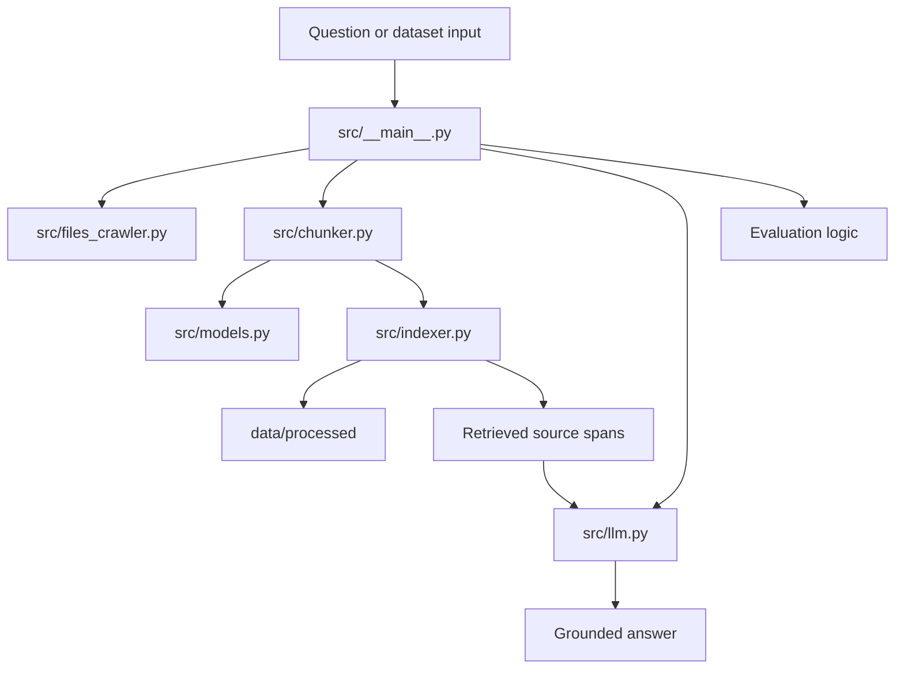

*This project has been created as part of the 42 curriculum by tobesson*

# RAG against the machine

## Description

This project implements a Retrieval-Augmented Generation (RAG) pipeline for a large codebase. The goal is to index a repository, retrieve the most relevant source snippets for a natural-language question, and feed those snippets to a local language model so that the final answer remains grounded in the codebase rather than in model memory.

The system is built around the vLLM repository provided in the project data. It ingests raw source files, splits them into chunks, builds a searchable lexical index, retrieves the best candidates for a question, and finally produces a structured answer with supporting source spans. The solution follows the project subject requirements and is designed to work from the CLI with `uv`.

## Instructions

### Prerequisites

- Python 3.10+
- `uv` installed and available on your PATH
- A local environment with enough disk space for the repository and model downloads

### Installation

```bash
uv sync
```

This installs the Python dependencies declared in the project configuration and prepares the environment for the CLI commands.

### Core commands

```bash
# Build the index on the raw corpus
uv run python -m src index --max_chunk_size 2000

# Search a single query
uv run python -m src search "how to enable LoRA adapters" --k 5

# Search a full dataset and save the result JSON
uv run python -m src search_dataset \
  --dataset_path data/datasets/UnansweredQuestions/dataset_docs_public.json \
  --k 10 \
  --save_directory data/output/search_results/UnansweredQuestions

# Answer a single query using the retrieved context
uv run python -m src answer "how to enable LoRA adapters" --k 5

# Generate answers for a whole dataset
uv run python -m src answer_dataset \
  --student_search_results_path data/output/search_results/UnansweredQuestions/dataset_docs_public.json \
  --save_directory data/output/search_results_and_answer/UnansweredQuestions

# Evaluate retrieval quality locally
uv run python -m src evaluate \
  --student_search_results_path data/output/search_results/UnansweredQuestions/dataset_docs_public.json \
  --dataset_path data/datasets/AnsweredQuestions/dataset_docs_public.json
```

### Makefile helpers

```bash
make install
make index ARGS="--max_chunk_size 2000"
make run
make debug
make lint
make lint-strict
make clean
make index
make search
make search_dataset
make answer
make answer_dataset
make evaluate
make recall
```

The make targets are provided to simplify common tasks, but the graded interface remains the CLI executed via `uv run python -m src ...`.

## System architecture

The project is intentionally split into small modules, each with a distinct responsibility:



The pipeline follows these stages:

1. Discovery: the crawler enumerates relevant corpus files from `data/raw/`.
2. Chunking: files are segmented into small, searchable units respecting the max context limit.
3. Indexing: chunks are stored in a lexical search index for fast similarity search.
4. Retrieval: the system ranks candidate chunks against a user query.
5. Generation: the highest-scoring evidence is inserted into the prompt sent to the local model.
6. Evaluation: retrieved sources are compared against reference answers using recall@k.

## Chunking strategy

The project implements two distinct chunking strategies, as required by the subject:

- Python chunking: for code files, the chunker uses structured parsing to keep logical blocks together, such as classes, functions, and top-level definitions. If a block is too large, it falls back to a safer line-based split.
- Markdown/text chunking: for documentation pages, the chunker splits on section and paragraph boundaries so that semantic context is preserved while keeping chunks under the 2000-character cap.

The chunker always stores source metadata as a `MinimalSource`, including:

- `file_path`
- `first_character_index`
- `last_character_index`

This guarantees that retrieved spans remain valid and compatible with the evaluation format.

## Retrieval method

The retrieval layer uses a classic lexical method: BM25.

This choice is a good fit for code and documentation because the same concepts often appear in both the query and the source text, and lexical ranking is fast, transparent, and easy to validate. The retriever:

- loads the saved index from `data/processed/`
- tokenizes the query and the indexed chunks consistently
- scores the chunks with BM25
- returns the top-k results in ranked order

Ranking quality is critical because the retrieved snippets are the only evidence the language model sees. If retrieval misses the right file or span, the final answer loses grounding.

## Performance analysis

The project aims to respect the subject constraints:

- indexing is performed under 20 seconds
- retrieval is performed under 5 seconds
- answer generation is performed under 5 seconds (on lenovo)

Recall@5: 
- 0.576 on code
- 0.850 on docs

## Design decisions

Several design choices are central to the project:

- Use of pydantic models to validate all exchanges between indexing, retrieval, and answer generation.
- Clean separation between file discovery, chunking, indexing, retrieval, and answering.
- Strict source-span tracking to keep each result tied to the exact file and character range.
- CLI-first execution so the project remains compatible with automated graders and manual testing.
- Support for both single-query and dataset-level flows, which is required by the RAG workflow and by the evaluation scripts.

## Challenges faced

The main difficulties were:

- not overcomplicate the project structure
- find motivation to continue the project after 2 month of inactivity
- optimize generation to not make the mac explode again (now it just became unusable but does not crash)
- keep the input and output formats clean and compatible with the evaluation scripts

## Resources

### References

- The subject requirements and evaluation criteria.
- Transform module.
- BM25 and lexical retrieval documentation.
- Call Me maybe for the model loading and tokenisaqtion.

### AI usage

AI tools was used for:

- drafting the initial README structure
- saying the text I wrote in the readme was irrelevant
- clearing up the logging system
- writing the docstring
- 

The implementation remains controlled by the author and every design choice was reviewed against the project specification rather than blindly copied from generated output.

## Example usage

```bash
# 1) Install dependencies
uv sync

# 2) Index the repository
uv run python -m src index --max_chunk_size 2000

# 3) Search a single question
uv run python -m src search "How do I configure the OpenAI-compatible server?" --k 5

# 4) Search the public docs dataset
uv run python -m src search_dataset \
  --dataset_path data/datasets/UnansweredQuestions/dataset_docs_public.json \
  --k 10 \
  --save_directory data/output/search_results/UnansweredQuestions

# 5) Generate answers from the search results
uv run python -m src answer_dataset \
  --student_search_results_path data/output/search_results/UnansweredQuestions/dataset_docs_public.json \
  --save_directory data/output/search_results_and_answer/UnansweredQuestions
```
