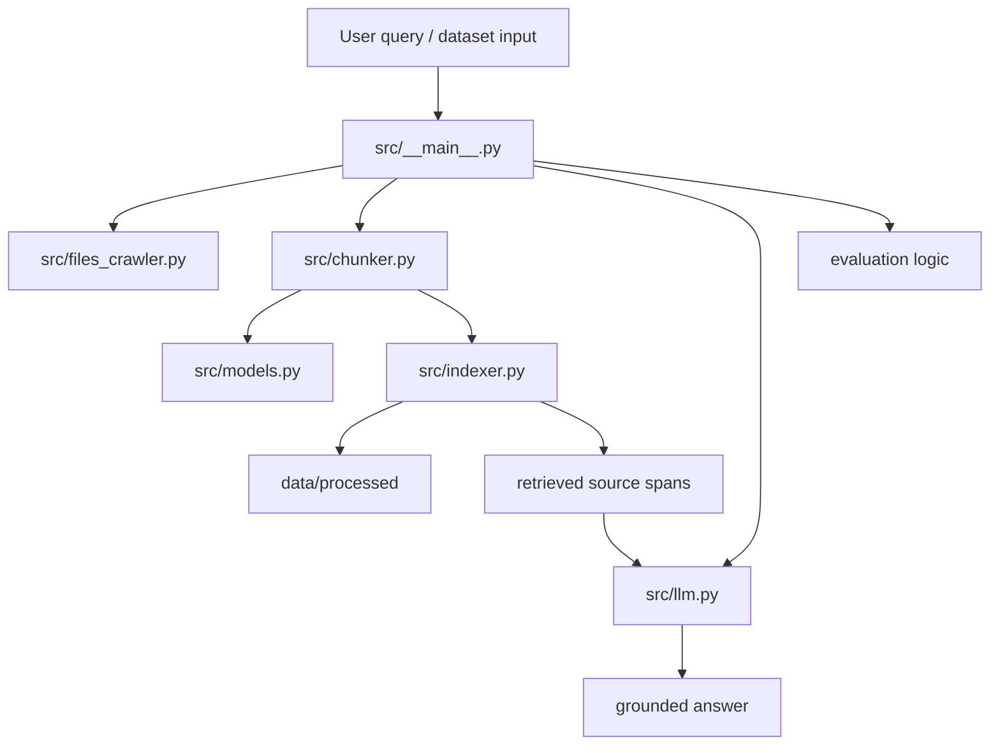

*This project has been created as part of the 42 curriculum by tobesson*

# RAG against the machine

This project builds a Retrieval-Augmented Generation (RAG) pipeline for a large codebase. The goal is to index a repository, find the most relevant source snippets for a natural-language question, feed those snippets to a local language model, and generate an answer grounded in the retrieved evidence.

The project follows the instructions described in the subject: ingest the vLLM repository, chunk files appropriately, build a searchable index, retrieve top-k candidates, then produce a JSON-based answer flow with source spans and evaluation metrics.

---

## 1. Project goal

A language model is frozen in time: it only knows what it saw during training. That is a problem when the question concerns a private repository, a recent library change, or a project-specific API. Instead of trying to insert all knowledge into the model, RAG keeps the model small and gives it access to the right evidence at query time.

In practice, the pipeline has four stages:

1. Indexing
   - Discover relevant files in a corpus.
   - Split them into manageable chunks.
   - Store the chunks in a retrievable index.

2. Retrieval
   - Tokenize the user query.
   - Search the index with a lexical ranking method.
   - Return the most relevant source locations.

3. Augmentation
   - Recover the actual text for each retrieved span.
   - Inject the relevant evidence into the prompt given to the model.

4. Generation
   - Ask a local model to answer the question using only the retrieved snippets.
   - Return a grounded answer and the supporting source references.

---

## 2. Mandatory subject requirements reflected in the code

The repository is designed around the subject constraints:

- Python 3.10+ project structure and proper CLI behavior.
- Pydantic models for validation and safe exchange between stages.
- At least one classical lexical retriever (BM25 is used here).
- Two chunking strategies:
  - Python chunking for Python files.
  - Markdown/plain-text chunking for documentation and prose files.
- Chunk size capped at 2000 characters as required by the subject.
- Command-Line Interface based on Python Fire.
- Progress bars via tqdm for long-running operations.
- Local model integration using the default Qwen/Qwen3-0.6B model.
- Retrieval evaluation through recall@k against dataset answers.

---

## 3. Detailed project workflow

### 3.1 Corpus discovery

The entry point is the project directory under data/raw. The crawler walks the directory tree recursively and keeps only file extensions that are considered indexable.

This is implemented in src/files_crawler.py:

- discovery(root_dir) recursively scans the directory tree.
- It accepts files with known text and Python extensions.
- It returns a flat list of file paths to be chunked and indexed.

This step isolates the raw ingestion logic from the rest of the pipeline and makes the system easier to extend to other corpora.

### 3.2 Chunking

Each file is not indexed as a whole: it is split into smaller source spans. This is essential to respect the 2000-character cap and to improve retrieval precision.

The logic lives in src/chunker.py and follows two main strategies:

- Python files: PythonChunker
  - Parses the file with Python’s AST.
  - Identifies top-level nodes and splits on meaningful code structure.
  - If a node is too large, it falls back to line-based splitting.

- Markdown / text files: TextChunker
  - Splits on paragraph boundaries, then punctuation, then whitespace.
  - Keeps prose chunks natural and readable while staying under the limit.

- Generic text fallback: PlainTextChunker
  - Used for files without a dedicated strategy.
  - Falls back to line-based segmentation.

The chunker produces MinimalSource objects representing:

- file_path
- first_character_index
- last_character_index

A MinimalSource is always constrained to stay within the 2000-character rule enforced by the Pydantic model in src/models.py.

### 3.3 Data model layer

The project exchanges data between stages as validated structures. This is defined in src/models.py.

Important models:

- MinimalSource
  - A file path and character span.
  - Prevents invalid spans and enforces length constraints.

- UnansweredQuestion
  - A question_id and the question string.

- AnsweredQuestion
  - Includes the question, its answer, and the supporting sources.

- RagDataset
  - A dataset containing a list of answered or unanswered questions.

- MinimalSearchResults
  - A question with the list of retrieved sources.

- StudentSearchResults / StudentSearchResultsAndAnswer
  - External JSON payloads used by CLI commands and evaluation.

This model layer ensures that data is validated before it travels between the retrieval, answer-generation, and evaluation stages.

### 3.4 Index construction

The indexing logic is in src/indexer.py.

The Indexer class coordinates the full retrieval backend:

- validate_directory(directory)
  - checks the corpus folder exists.

- ChunkCollector.collect_chunks()
  - discovers files and stores all generated source spans.

- fetch_all()
  - reads the text for each chunk and assembles the corpus.

- build_index()
  - tokenizes the chunk texts with BM25S and Stemmer.
  - creates the BM25 index.

- save()
  - writes the BM25 model and the chunk metadata to data/processed.

- load()
  - reloads the saved index and chunk list for later searches.

The BM25 retriever is the core lexical ranking method. Each chunk becomes a document. The query is tokenized in the same way, and the most relevant chunks are returned by score.

### 3.5 Retrieval stage

Once the corpus is indexed, a question is sent to the retriever.

The search flow is:

1. validate query and k
2. load the existing index from disk
3. tokenize the question
4. ask BM25 for the top-k chunks
5. return a list of (MinimalSource, score)

This is the key operation that decides which evidence is passed to the model. Good retrieval is the difference between a correct grounded answer and a hallucinated one.

The CLI exposes:

- index: build the corpus index
- search: query a single question
- search_dataset: run retrieval over a whole dataset and save a JSON result file

### 3.6 Answer generation

The local model wrapper is defined in src/llm.py.

The main class is LocalRAGModel.

It performs three important jobs:

- build_prompt(question, sources)
  - keeps only the most relevant sentences from the retrieved sources
  - assembles a compact evidence-based prompt

- generate(prompt)
  - loads the model with AutoTokenizer and AutoModelForCausalLM
  - runs generation with the selected Qwen model

- answer(question, sources)
  - produces the final answer using the retrieved context
  - falls back to a grounded extraction when model initialization fails

The generation prompt explicitly tells the model to answer only from the supplied evidence. This is crucial for a grounded pipeline and helps reduce hallucination.

### 3.7 Evaluation

The project also implements retrieval evaluation in src/__main__.py.

The evaluator compares student search results against an answered dataset and computes recall@k. This is important for the subject requirement that the retriever reaches a threshold such as:

- recall@5 on documentation questions
- recall@5 on code questions

The metric logic compares candidate source spans to ground-truth sources and checks whether they overlap sufficiently.

This is the stage that tells whether the retrieval engine is useful enough for the full RAG flow.

---

## 4. How the modules interact with each other

The project is intentionally split into small modules, each with a clear responsibility:



### Module by module

- src/__main__.py
  - Fire CLI entry point.
  - Wires the whole pipeline together.
  - Exposes commands such as index, search, answer, and evaluate.

- src/files_crawler.py
  - Discovers candidate files in the target corpus.
  - Sends them to the chunker.

- src/chunker.py
  - Splits source files into valid spans.
  - Produces MinimalSource objects used by the indexer.

- src/models.py
  - Validates all exchanges: questions, source spans, retrieval results, answers.

- src/indexer.py
  - Builds and loads the BM25 index.
  - Retrieves the top-k relevant chunks for a query.

- src/llm.py
  - Converts evidence into prompt text.
  - Loads the local Qwen model and answers the question.

The design is modular on purpose: every stage is independent, but the pipeline only works correctly when they agree on the same data contract.

---

## 5. Typical execution flow

A complete use case looks like this:

1. Run the index command.
   - The system walks the repository.
   - Files are split into chunks.
   - The BM25 index is trained and saved.

2. Ask a question.
   - Example: "How do I load a LoRA adapter in vLLM?"
   - The search layer tokenizes the query and retrieves the top-k relevant chunks.

3. Extract source text.
   - The system reads the exact file slices for each retrieved source.

4. Build the prompt.
   - The model sees the relevant evidence and nothing else.

5. Generate the answer.
   - The model responds based on the retrieved context.

6. Evaluate the retrieval.
   - If the project is compared with a reference dataset, Recall@k is measured against source span overlaps.

---

## 6. Folder structure

- src/
  - Core pipeline implementation.
- data/
  - raw corpus, processed index, datasets, and output JSON.
- Makefile
  - Common tasks: install, index, run, search, evaluate.
- pyproject.toml
  - project metadata and dependencies.

---

## 7. Useful commands

### Install dependencies

```bash
make install
```

### Build the index

```bash
uv run python -m src index --max_chunk_size 2000
```

### Search one question

```bash
uv run python -m src search "how to load a LoRA adapter" --k 5
```

### Search an entire dataset

```bash
uv run python -m src search_dataset \
  --dataset_path data/datasets/UnansweredQuestions/dataset_docs_public.json \
  --k 10 \
  --save_directory data/output/search_results/UnansweredQuestions
```

### Answer one question

```bash
uv run python -m src answer "how to load a LoRA adapter" --k 10
```

### Produce answers for a whole dataset

```bash
uv run python -m src answer_dataset \
  --student_search_results_path data/output/search_results/UnansweredQuestions/dataset_docs_public.json \
  --save_directory data/output/search_results_and_answer
```

### Evaluate results against a reference dataset

```bash
uv run python -m src evaluate \
  data/output/search_results/UnansweredQuestions/dataset_docs_public.json \
  data/datasets/AnsweredQuestions/dataset_docs_public.json \
  --k 10
```

---

## 8. Why this design is suited to the project

This implementation intentionally uses a classic retriever and a grounded generation loop because it matches the subject exactly:

- lexical retrieval is fast and explainable;
- chunking keeps evidence narrow and relevant;
- local model generation is lightweight and easier to run without external services;
- source-span validation keeps outputs aligned with the grading rules;
- the pipeline is easy to reason about and debug.

The whole system is a textbook RAG architecture: index, retrieve, augment, answer, and evaluate.

---

## 9. Summary

The project turns a large codebase into a queryable evidence store, then answers questions by grounding the model in retrieved code or documentation snippets. The pipeline is centered around:

- file discovery,
- file-type-aware chunking,
- BM25 indexing,
- top-k source retrieval,
- prompt-based answer generation,
- evaluation and metrics.

This is the core of a real RAG system for code understanding, and it follows the subject’s required architecture and constraints.
